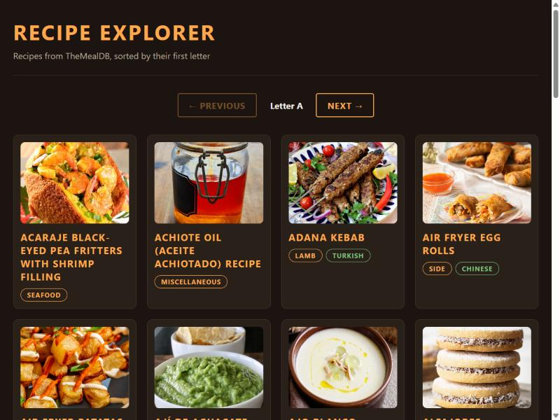
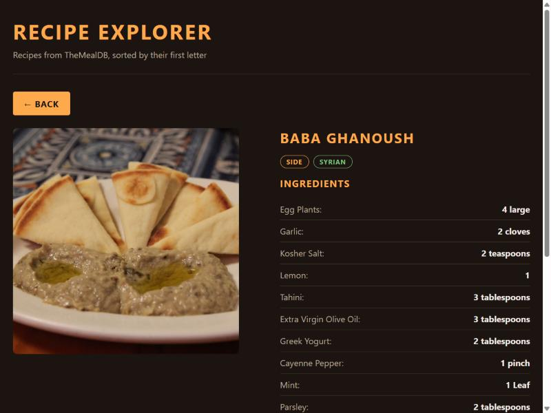

# Recipe Explorer

React application that shows recipes from **TheMealDB** public API. It has a **general view** with a grid of recipes (sorted by their first letter) and a **detail view** with the image, ingredients and instructions of the selected recipe.

The project follows **Atomic Design** for the components and **BEM** for the CSS class names.

Repository: https://github.com/Reilox79/Final-Project-1Term

## Group members

- _Mario Garcia Oliva_ 
- _Rafa Lora Calero_
- _Fernando Ortega Lomeli_

## Chosen API

**TheMealDB** – free recipe API, no API key needed.
Documentation: https://www.themealdb.com/api.php

> We first chose SWAPI (Star Wars), but it does not return images, so we changed to TheMealDB, which has a photo for every recipe.

## File structure

```
Final-Project-1Term/
├── docs/                   → screenshots for this README
├── public/                 → static files (favicon)
├── src/
│   ├── services/
│   │   └── api.js          → ALL the fetch calls to the API
│   ├── components/
│   │   ├── atoms/          → smallest pieces (Button, Image, Title...)
│   │   ├── molecules/      → groups of atoms (MealCard, InfoRow...)
│   │   ├── organisms/      → big sections (Header, MealList, MealDetail)
│   │   ├── templates/      → page layout without data (MainTemplate)
│   │   └── pages/          → templates filled with API data
│   ├── App.jsx             → decides which page to show (useState)
│   ├── main.jsx            → entry point, renders <App />
│   └── index.css           → global styles and colour variables
├── index.html
├── package.json
└── README.md
```

Every component has its own `.css` file next to it.

## Example of API access

**Request (list of meals that start with "a"):**

```
GET https://www.themealdb.com/api/json/v1/1/search.php?f=a
```

**Request (one meal by id):**

```
GET https://www.themealdb.com/api/json/v1/1/lookup.php?i=52772
```

**Extract of the JSON response:**

```json
{
  "meals": [
    {
      "idMeal": "52772",
      "strMeal": "Teriyaki Chicken Casserole",
      "strCategory": "Chicken",
      "strArea": "Japanese",
      "strInstructions": "Preheat oven to 350° F...",
      "strMealThumb": "https://www.themealdb.com/images/media/meals/wvpsxx1468256321.jpg",
      "strIngredient1": "soy sauce",
      "strMeasure1": "3/4 cup",
      "strIngredient2": "water",
      "strMeasure2": "1/2 cup"
    }
  ]
}
```

**Service functions (`src/services/api.js`):**

```js
const BASE_URL = "https://www.themealdb.com/api/json/v1/1";

export async function getMealsByLetter(letter) {
  const response = await fetch(`${BASE_URL}/search.php?f=${letter}`);
  if (!response.ok) throw new Error("Error fetching meals");

  const data = await response.json();
  // If there are no meals, the API returns { meals: null }
  return data.meals || [];
}

export async function getMealById(id) {
  const response = await fetch(`${BASE_URL}/lookup.php?i=${id}`);
  if (!response.ok) throw new Error("Error fetching meal");

  const data = await response.json();
  if (!data.meals) throw new Error("Meal not found");

  const meal = data.meals[0];

  // The API gives the ingredients in 20 separate fields, so we join them in one array
  const ingredients = [];
  for (let i = 1; i <= 20; i++) {
    const name = meal[`strIngredient${i}`];
    const measure = meal[`strMeasure${i}`];
    if (name && name.trim() !== "") {
      ingredients.push({ name, measure });
    }
  }

  return { ...meal, ingredients };
}
```

Components never call `fetch` directly: they always use these functions.

## Components

### Atoms
- **Button** – button with `primary` / `secondary` variants.
- **Image** – image with `small` (card) / `large` (detail) sizes.
- **Title** – heading (`h1`–`h6`) with `small` / `medium` / `large` sizes.
- **Text** – paragraph or span with `normal` / `muted` / `strong` variants.
- **Badge** – small label for the category or the area (country) of a meal.
- **Spinner** – loading animation.
- **ErrorMessage** – box that shows an error text.

### Molecules
- **MealCard** – clickable card with image, name and badges of a meal.
- **InfoRow** – one row with a label and a value (used for the ingredients).
- **Pagination** – "Previous" / "Next" buttons and the current letter.

### Organisms
- **Header** – title and subtitle of the app.
- **MealList** – grid of `MealCard`s (or a message if there are no meals).
- **MealDetail** – full information of one meal: image, badges, ingredients and instructions.

### Templates
- **MainTemplate** – common layout: `Header` on top and the page content below.

### Pages
- **HomePage** – general view. Loads the meals of the current letter and shows `Pagination` + `MealList`.
- **DetailPage** – detail view. Loads one meal by id and shows a "Back" button + `MealDetail`.

## Navigation

We do not use React Router. In `App.jsx` there is one state:

```js
const [selectedId, setSelectedId] = useState(null);
```

- If `selectedId` is `null` → `HomePage` (general view) is shown.
- When the user clicks a `MealCard`, `setSelectedId(meal.idMeal)` is called → `DetailPage` is shown.
- The "Back" button calls `setSelectedId(null)` → we go back to the general view.

## Hooks

| Where | Hook | Why |
|-------|------|-----|
| `App.jsx` | `useState` | `selectedId`: which view is shown (navigation). |
| `HomePage.jsx` | `useState` | `meals`, `letterIndex`, `loading`, `error`. |
| `HomePage.jsx` | `useEffect` | Calls `getMealsByLetter(letter)` when the page loads and every time the letter changes (dependency array `[letter]`). |
| `DetailPage.jsx` | `useState` | `meal`, `loading`, `error`. |
| `DetailPage.jsx` | `useEffect` | Calls `getMealById(id)` when the page opens (dependency array `[id]`). |

The dependency arrays avoid infinite requests: the effect only runs again when that value changes.

## How to run the project

```bash
npm install
npm run dev
```

Then open the URL that Vite shows (usually http://localhost:5173).

## Screenshots

**General view**



**Detail view**


